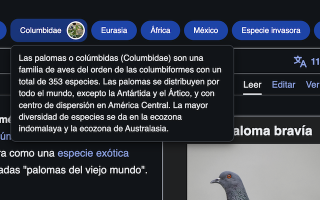
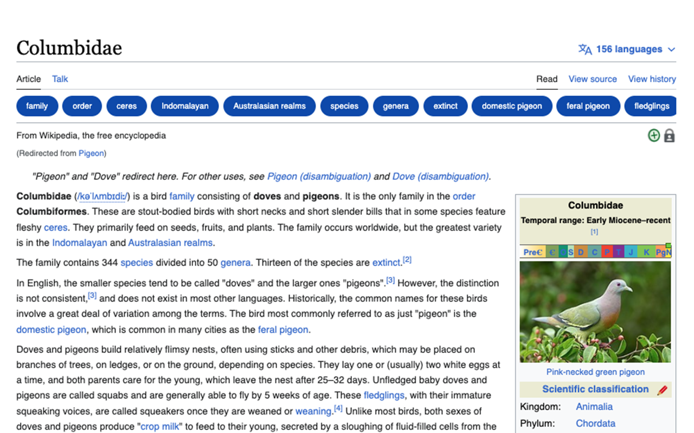

<!--

██████╗ ██╗ ██████╗ ███████╗ ██████╗ ███╗   ██╗
██╔══██╗██║██╔════╝ ██╔════╝██╔═══██╗████╗  ██║
██████╔╝██║██║  ███╗█████╗  ██║   ██║██╔██╗ ██║
██╔═══╝ ██║██║   ██║██╔══╝  ██║   ██║██║╚██╗██║
██║     ██║╚██████╔╝███████╗╚██████╔╝██║ ╚████║
╚═╝     ╚═╝ ╚═════╝ ╚══════╝ ╚═════╝ ╚═╝  ╚═══╝

██████╗  ██████╗ ███████╗███████╗███████╗
██╔══██╗██╔═══██╗██╔════╝██╔════╝██╔════╝
██████╔╝██║   ██║███████╗███████╗█████╗
██╔═══╝ ██║   ██║╚════██║╚════██║██╔══╝
██║     ╚██████╔╝███████║███████║███████╗
╚═╝      ╚═════╝ ╚══════╝╚══════╝╚══════╝

█████╗█████╗█████╗█████╗█████╗█████╗█████╗█████╗
╚════╝╚════╝╚════╝╚════╝╚════╝╚════╝╚════╝╚════╝

██╗    ██╗██╗██╗  ██╗██╗██████╗ ███████╗██████╗ ██╗ █████╗
██║    ██║██║██║ ██╔╝██║██╔══██╗██╔════╝██╔══██╗██║██╔══██╗
██║ █╗ ██║██║█████╔╝ ██║██████╔╝█████╗  ██║  ██║██║███████║
██║███╗██║██║██╔═██╗ ██║██╔═══╝ ██╔══╝  ██║  ██║██║██╔══██║
╚███╔███╔╝██║██║  ██╗██║██║     ███████╗██████╔╝██║██║  ██║
 ╚══╝╚══╝ ╚═╝╚═╝  ╚═╝╚═╝╚═╝     ╚══════╝╚═════╝ ╚═╝╚═╝  ╚═╝

██████╗ ██╗     ██╗   ██╗███████╗
██╔══██╗██║     ██║   ██║██╔════╝
██████╔╝██║     ██║   ██║███████╗
██╔═══╝ ██║     ██║   ██║╚════██║
██║     ███████╗╚██████╔╝███████║
╚═╝     ╚══════╝ ╚═════╝ ╚══════╝

CREATED BY ANGELO
DEVELOPED BY PIGEONPOSSE

 -->

# Wikipedia Plus Extension _(Chrome, Safari, Firefox, Brave etc)_

WikipediaPlus is the perfect tool to enhance your browsing experience on Wikipedia. This extension allows you to quickly and efficiently access all relevant links on the page you're visiting. With its interactive banner, you can easily explore all links without interruptions. With WikipediaPlus, you can save time and increase productivity while learning and discovering new information on Wikipedia.

|  |  |
| ------------------------- | ------------------------- |

🧩 Download links:

- 
- 
- 

## 👨‍💻 Development

You can contribute via **_Github_**.

## ☕ Donate

Help us to develop more interesting things.

## 📜 License

This software is licensed with GPLv3 (GNU GENERAL PUBLIC LICENSE Version 3).

## 🐦 About us

_PigeonPosse_ is a ✨ **code development collective** ✨ focused on creating practical and interesting tools that help developers and users enjoy a more agile and comfortable experience. Our projects cover various programming sectors and we do not have a thematic limitation in terms of projects.

### Collaborators

|                                                                                    | Name        | Role         | GitHub                                         |
| ---------------------------------------------------------------------------------- | ----------- | ------------ | ---------------------------------------------- |
|  | AngelEspejo | Author & Development      | [@AngelEspejo](https://github.com/AngelEspejo) |
| " alt="avatar" style="border-radius:100%"/>   | Alejo      | Author & Design      | [@AlejoMalia](https://github.com/AlejoMalia) |
| " alt="avatar" style="border-radius:100%"/> | PigeonPosse | Collective   | [@PigeonPosse](https://github.com/PigeonPosse) |
